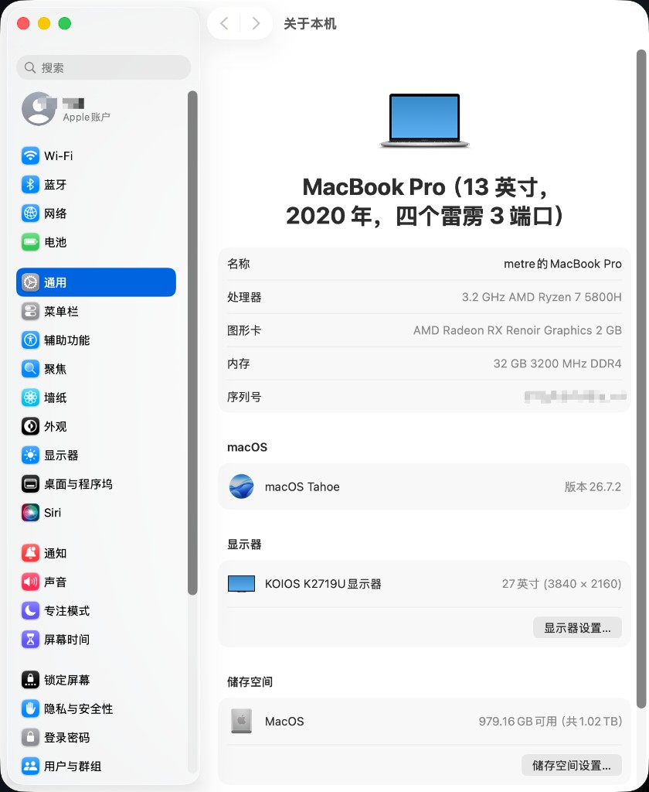

# Yoga 14s ACH 2021 — macOS Tahoe 26.7 EFI



联想 Yoga 14s ACH 2021（82MS）。Ryzen 7 5800H，Radeon Vega（Cezanne `1002:1638`），Realtek ALC287，Intel AX200。系统盘为内置 Fanxiang。

基于 macOS Tahoe **26.7.1**，已正常升级到 **26.7.2**。

OpenCore **1.0.8 RELEASE**。BIOS 为定制固件 GZCN27WW，因此不支持升级；该固件包含 32 GB 内存支持。本机 32 GB 为硬改内存，原厂为 16 GB。此配置理论上适用于 16 GB 原版。配置文件为 `EFI/OC/config.plist`。

## 1. 当前配置与硬件状态

### 1.1 引导

| 项 | 值 |
| --- | --- |
| OpenCore | 1.0.8 RELEASE（`BOOTx64.efi`、`OpenCore.efi`、`OpenRuntime.efi`、`OpenCanopy.efi`、`ResetNvramEntry.efi`） |
| `HfsPlus.efi` | acidanthera/OcBinaryData |
| `boot-args` | `keepsyms=1 -FIPeriodic -NRedDisplayFix -NRedVideoFix` |
| `Misc.Debug.Target` | `0` |
| `AppleDebug` / `LogModules` | `false` / 空 |
| `DisplayLevel` | `2147483650` |
| `ApplePanic` | `true`（panic 写成 EFI 根目录 `panic-*.txt`） |
| `EnableWriteUnprotector` | `true` |
| `RebuildAppleMemoryMap` | `false` |
| `SyncRuntimePermissions` | `false` |
| RestrictEvents | `revcpu=1`，`revcpuname=AMD Ryzen 7 5800H`，`revpatch=auto,sbvmm` |
| `csr-active-config` | `03080000` |
| SMBIOS | `MacBookPro16,2`。`SystemSerialNumber`、`MLB` 为空，`SystemUUID` 与 `ROM` 为全 0 |

`keepsyms=1` 供 SimpleHDA 使用。`-FIPeriodic` 做 TSC 周期同步。`-NRedDisplayFix -NRedVideoFix` 属于当前这份 NootedRed。

写入本机 EFI 前填写序列号、MLB、UUID，ROM 填网卡 MAC 的 6 字节。使用 iCloud / iMessage 前，到 [Apple 保修查询](https://checkcoverage.apple.com/) 确认序列号显示“无效”。

### 1.2 硬件状态

状态以 Tahoe 26.7 在本机上的结果为准。

| 硬件 | 状态 | 实现 |
| --- | --- | --- |
| 处理器 | 正常 | AMD_Vanilla PR #215 内核补丁，核心数 `08`；AMDRyzenCPUPowerManagement 0.7.2、SMCAMDProcessor |
| 核显、内屏 | 正常 | NootedRed。Metal 3，显存 2 GB。华星 CSOT `MNE007ZA1-1`，2880×1800，缩放 1440×900 @ 90 Hz，30-bit |
| 视频硬解、硬编 | 正常 | VCN 2，`AMDRadeonVADriver2`。H.264、HEVC（Main / Main 10，最高等级 5.1）可硬解、硬编。VP9、AV1、MPEG-2、MPEG-4、JPEG 无硬解 |
| 外接显示 | 正常 | 3840×2160 @ 60 Hz，30-bit。机身 HDMI 在 NootedRed 下识别为 DisplayPort |
| 亮度 | 正常 | BrightnessKeys 1.0.3 |
| 扬声器、麦克风 | 正常 | AppleALC 1.9.8 + SimpleHDA 1.0.0，`layout-id = 13`，普通 IOAudio。HAL 插件未安装 |
| 外接显示器音频 | 无输出 | 音频设备会建立，链路上没有有效数据。内置扬声器不受影响 |
| 无线 AX200 | 正常，功能受限 | AirportItlwm-Tahoe。Wi-Fi 6、纯 WPA3、强制 PMF、AirDrop 不可用 |
| 蓝牙 | 已加载，启动无 panic | IntelBluetoothFirmware / IntelBTPatcher 2.4.0 + BlueToolFixup 2.7.2 |
| 触摸板 | 正常 | VoodooI2C 2.8。`YogaSMC.kext` 必须保持启用，否则 `VoodooInput` 不加载 |
| 键盘 | 正常 | VoodooPS2Controller 2.3.7。OpenCanopy 超时 3 秒，固件菜单只接受 USB 键盘 |
| Fn+Q 性能模式 | 正常 | YogaSMC 转发 VPC 事件，YogaControl 接收 |
| 键盘背光 | 仅硬件键 | Fn+空格。YogaSMC 报告本机不支持软件切换 |
| 电池读数 | 正常 | 原生 `_BIF` / `_BST` + ECEnabler 1.0.6 + SMCBatteryManager |
| 性能模式功耗 | 正常 | DYTC rev 5。短时满载：安静约 12 W / 1.5 GHz，均衡约 24 W / 2.7 GHz，性能约 40 W / 3.7 GHz。机身热透后性能模式持续约 32–36 W / 2.4–2.7 GHz（约 86 °C）。封装功耗含核显 |
| USB | 正常 | XHC0 / XHC1 原生枚举，未使用 USBMap |
| 摄像头 | 正常 | 系统自带 USB 视频 |
| 睡眠 | 部分 | `hibernatemode 0`，只做内存睡眠。休眠到磁盘后再唤醒的固件映射未改 |
| 内置 NVMe | 可用，速率不足 | Fanxiang 能启动。链路停在 5.0 GT/s x4，见 3.5 |
| 有线网 | 无此硬件 | `NullEthernet` 与 `SSDT-RMNE` 关闭，AX200 作为 `en0` |

重启前先拔扩展坞，系统把无线登记为 `en0`；之后再插入，扩展坞排在 `en0` 后面。

### 1.3 加载项

ACPI 正在加载：`SSDT-XOSI`、`SSDT-ALS0`、`SSDT-EC`、`SSDT-PLUG-ALT`、`SSDT-PNLF`（`GP17.VGA`）、`SSDT-USBX`。`SSDT-RMNE` 不加载。

DeviceProperties：`PciRoot(0x1)/Pci(0x8,0x1)/Pci(0x0,0x6)` 的 `layout-id = 13`，`Pci(0x0,0x5)` 的 `external-audio`。`\_SB.PCI0` 的 `_UID` 为 1，所以路径是 `PciRoot(0x1)`。日志和 Windows 里的 `PciRoot(0x0)` 是固件编号，不能写入 DeviceProperties。内置盘插槽 `PciRoot(0x1)/Pci(0x2,0x4)/Pci(0x0,0x0)` 上无注入属性。

启用的 kext，顺序同 `Kernel → Add`：

Lilu 1.7.2、VirtualSMC / SMCBatteryManager / SMCLightSensor 1.3.8、ForgedInvariant 1.5.0、ECEnabler 1.0.6、AppleMCEReporterDisabler、AMDRyzenCPUPowerManagement 0.7.2、SMCAMDProcessor、NootedRed、NVMeFix 1.1.3、RestrictEvents 1.1.6、VoodooPS2 2.3.7、VoodooI2C 2.8（VoodooGPIO、VoodooI2CServices、VoodooInput）、VoodooI2CHID、BrightnessKeys 1.0.3、AppleALC 1.9.8、SimpleHDA 1.0.0、YogaSMC 1.5.3、IntelBluetoothFirmware、IntelBTPatcher、BlueToolFixup 2.7.2、AirportItlwm-Tahoe。

SimpleHDA 与 AirportItlwm-Tahoe 限定 Darwin 25.x。SimpleHDA 位于 Lilu、AppleALC 之后。

关闭，文件仍在目录中：

| kext | 原因 |
| --- | --- |
| USBMap | 每个控制器端口少于 15 个。开启后安装阶段停在 `Waiting on boot-uuid-media` |
| FeatureUnlock 1.1.8 | `MaxKernel` 为 24.99.99，Tahoe 不加载 |
| NullEthernet | 本机无网口。虚拟网卡会占掉 `en0` |

系统侧（不在 EFI 内，重装后需重做）：

- 内屏名称：把 `PostInstall/DisplayOverride/` 复制到 `/Library/Displays/Contents/Resources/Overrides/`。名称 `Yoga 14s 2.8K (CSOT MNE007ZA1-1)`。EDID 三原色和白点与 sRGB 一致，颜色描述用默认或 sRGB IEC61966-2.1。
- 电源：`pmset -a` 为 `powernap 0`、`tcpkeepalive 0`、`proximitywake 0`、`standby 0`、`hibernatemode 0`。睡眠期间“查找我的 Mac”不可用。
- 性能模式面板：[YogaControl](../YogaControl/README.md)，安装于 `/Applications/YogaControl.app`。原版 YogaSMCNC 与偏好面板已卸载。
- `PostInstall/SimpleHDA-HAL-1.0.0.pkg` 未安装。插件为 ad-hoc 签名，与开启 library-validation 的豆包输入法冲突。

检查：

```sh
ioreg -lw0 -r -n IGPU | grep -E 'NRed(CacheSectionRevision|ComputeScratchVersion|LegacyBlendVersion|SubmitGuardApplied|VCNUserDynamicMatched|OpenGLEnabled)'
kextstat | grep -E 'AppleALC|SimpleHDA|AppleHDA|AirportItlwm|IntelBluetooth|BlueToolFixup'
sysctl machdep.tsc
ioreg -rn IdeaVPC -d1
```

## 2. 第三方显卡与网卡

核显和无线不是本机编写的驱动。版本、构建和校验写在 `components.json`。

### 2.1 核显

| 项 | 值 |
| --- | --- |
| 硬件 | AMD Radeon Graphics，Cezanne `1002:1638` |
| 驱动 | NootedRed |
| 版本 | 0.9.0-pre-release.11，CacheSectionRepair RELEASE |
| 发布 | [steve12311/NootedRed v0.9.0-pre-release.11](https://github.com/steve12311/NootedRed/releases/tag/v0.9.0-pre-release.11) |
| 选用原因 | 作者在 Ryzen 7 5800H、Tahoe 26.7.2 上调查过这一构建。同平台可参考 [Kingtous/thinkbook14p-Gen2-ACH-hackintosh](https://github.com/Kingtous/thinkbook14p-Gen2-ACH-hackintosh) |
| 本机参数 | `boot-args` 含 `-NRedDisplayFix -NRedVideoFix` |
| 本机识别 | AMD Radeon RX Renoir Graphics，`1002:1638`，修订 `0x00c5`，ROM `113-CEZANNE-017`，PCIe x16 |
| 本机显示 | 内屏 2880×1800 @ 90 Hz，30-bit。外接 3840×2160 @ 60 Hz，30-bit。Metal 3 |
| 补丁属性 | `NRedCacheSectionRevision = 1`，`NRedComputeScratchVersion = 1`，`NRedLegacyBlendVersion = 1`，`NRedSubmitGuardApplied = 16`，`NRedVCNUserDynamicMatched = 1`，`NRedOpenGLEnabled = 1` |
| 硬解 | VCN 2，驱动 `AMDRadeonVADriver2`。H.264、HEVC 硬解和硬编均解出画面；HEVC 为 Main / Main 10，最高等级 5.1。传统 VDA 可创建。VP9、AV1、MPEG-2、MPEG-4、JPEG 系统不提供硬解 |

这是预发布构建。小版本更新不必先关闭它。跨大版本或全新安装时，安装阶段再暂时停用。外接音频无输出是这份 NootedRed 在 Renoir 上的限制，`external-audio` 已经注入。

### 2.2 无线与蓝牙

AX200 是组合卡。无线和蓝牙来自两个项目。

| 项 | 无线 | 蓝牙 |
| --- | --- | --- |
| 驱动 | AirportItlwm-Tahoe | IntelBluetoothFirmware、IntelBTPatcher、BlueToolFixup |
| 版本 | 2.4.0-alpha，提交 `738d4c6` | 2.4.0；BlueToolFixup 2.7.2 |
| 发布 | [laobamac/itlwm](https://github.com/laobamac/itlwm) | [OpenIntelWireless/IntelBluetoothFirmware 2.4.0](https://github.com/OpenIntelWireless/IntelBluetoothFirmware)、[acidanthera/BrcmPatchRAM 2.7.2](https://github.com/acidanthera/BrcmPatchRAM) |
| 界面 | 原生 Wi-Fi | 系统蓝牙栈 |
| 内核范围 | Darwin 25.x | 官方 2.4.0 |

同平台参考配置使用非官方蓝牙 2.5.0。本机固定官方 2.4.0。Wi-Fi 6 默认关闭，原因见 3.4。

### 2.3 其余第三方组件

| 组件 | 版本 | 来源 |
| --- | --- | --- |
| OpenCorePkg | 1.0.8 | [acidanthera/OpenCorePkg](https://github.com/acidanthera/OpenCorePkg) |
| Lilu / VirtualSMC / AppleALC / RestrictEvents | 1.7.2 / 1.3.8 / 1.9.8 / 1.1.6 | acidanthera |
| NVMeFix / FeatureUnlock / VoodooPS2 / BrightnessKeys | 1.1.3 / 1.1.8 / 2.3.7 / 1.0.3 | acidanthera |
| ECEnabler | 1.0.6 | [averycblack/ECEnabler](https://github.com/averycblack/ECEnabler) |
| ForgedInvariant | 1.5.0 | [ChefKissInc/ForgedInvariant](https://github.com/ChefKissInc/ForgedInvariant) |
| SimpleHDA | 1.0.0 | [laobamac/SimpleHDA](https://github.com/laobamac/SimpleHDA) |
| VoodooI2C / VoodooI2CHID | 2.8 | [VoodooI2C](https://github.com/VoodooI2C/VoodooI2C) |
| YogaSMC | 1.5.3 | [zhen-zen/YogaSMC](https://github.com/zhen-zen/YogaSMC) |
| AMD 内核补丁 | PR #215 @ `a174cca` | [AMD-OSX/AMD_Vanilla#215](https://github.com/AMD-OSX/AMD_Vanilla/pull/215) |
| HfsPlus.efi | OcBinaryData master | [acidanthera/OcBinaryData](https://github.com/acidanthera/OcBinaryData) |

13 个 Release 包的 SHA-256 与 GitHub 记录一致。NootedRed 与作者附带的 `SHA256SUMS` 一致。VoodooPS2 2.3.7、BrightnessKeys 1.0.3、IntelBluetooth 2.4.0 的发布页没有摘要，`components.json` 中为本地计算值。

`efi_init` 不在上表中。它是写在 `config.plist` 里的本机内核补丁，没有独立源文件。

## 3. 本机改动

每条写根因、改动，以及能否用到别的机器。

### 3.1 写 NVRAM 整机冻结：`efi_init`

**根因。** 固件没有 MAT（`MAT support is 0`）。固件运行时驱动的整块镜像，包括数据页，都被标成 `EfiRuntimeServicesCode`。XNU `efi_init`（`osfmk/i386/AT386/model_dep.c`）把这类区域映射成只读可执行。固件写 NVRAM 时改自己的数据页，触发写只读页，整机冻结。这一步早于任何 kext，OpenCore 事先改过的页权限会被盖掉。NVRAM 介质本身正常。

**改动。** `Kernel → Patch` 一条，注释 `efi_init: map EfiRuntimeServicesCode RWX instead of RX`。Darwin 25.0.0–25.99.99，`Count = 1`。Find / Replace 各 20 字节，第 12 字节 `4d` → `8d`：`lea ecx, [rcx*2+3]`（RX）改为 `lea ecx, [rcx*4+3]`（RWX）。数据区仍可写。字节取自 Tahoe 26.7 的 `BootKernelExtensions.kc`，在内核缓存中唯一匹配。同时保持 `EnableWriteUnprotector = true`、`RebuildAppleMemoryMap = false`、`SyncRuntimePermissions = false`。`hibernate_newruntime_map` 中的同一指令未改，休眠到磁盘后再唤醒不走这条补丁，因此 `hibernatemode` 保持 0。

**是否通用。** 无 MAT、且运行时镜像被标成 `EfiRuntimeServicesCode` 的固件属于同一类。有 MAT 的机器用 `RebuildAppleMemoryMap`，不要打这条补丁。字节只对应 Darwin 25 的这条 `lea`。小版本更新后确认 OpenCore 日志里 Count 仍为 1；变为 0 或超出 25.99.99 时，需按新内核重新取字节。

### 3.2 拔出罗技 USB 接收器后内核 panic

**根因。** `VoodooI2CHID` 2.8 的 Multitouch、Stylus、Touchscreen 不限总线。USB 上带触摸用途页（Usage Page `0x0D`）的接口被认成触摸设备，`VoodooInput` 再包一层模拟触控板。接收器拔出时，该 HID 设备在 `IOHIDDevice::didTerminate` 空指针 panic。内置触摸板在 I2C 上，不依赖这三条 USB 匹配。

**改动。** 本机这份 `VoodooI2CHID.kext` 的上述三个 personality 增加 `IOPropertyMatch` / `Transport = I2C`。Generic Mouse 与 Precision Touchpad 原先已限定 I2C。继续使用 2.8：正式版 2.9.1 的触摸板回退仍未修复。替换成上游整包会丢掉这三行。

**是否通用。** 使用未限制总线的 VoodooI2CHID，且 USB 上有触摸描述符的机器会遇到同一故障。这不是接收器固件的缺陷。

### 3.3 启动黑屏：AMD 各核 TSC 不对齐

**根因。** 各核 TSC 不一致。macOS 要求各核时间戳同步，本机固件不保证。调度停在用户态，停在 `IOConsoleUsers` 附近，不 panic，也不再读写磁盘。打开 NootedRed 时表现为黑屏，是显示被接管之后的结果。`AmdTscSync` 不能用于这份核显驱动；NootedRed 只认可 ForgedInvariant（[ChefKissInc/NootedRed#270](https://github.com/ChefKissInc/NootedRed/issues/270)）。Tahoe 26.4 及以上，非单调时间还会在 `thread_invoke` / `thread_dispatch` 中 panic。

**改动。** 使用 ForgedInvariant 1.5.0，紧跟 Lilu 与 VirtualSMC，`boot-args` 含 `-FIPeriodic`。不与 AmdTscSync、VoodooTSCSync、CpuTscSync 同时启用。另加 [AMD_Vanilla PR #215](https://github.com/AMD-OSX/AMD_Vanilla/pull/215)（`a174cca`）里 Darwin 25.4.0–25.99.99 的 laobamac 时间补丁。26.7 是 Darwin 25.7，需要这一组。该 PR 尚未进入 master。

**是否通用。** ForgedInvariant 替代 AmdTscSync，以及 PR #215 的 26.4 以上时间补丁，适用于同期 AMD 系统。

### 3.4 打开 Wi-Fi 6 后登录界面全黑

**根因。** 这份 AirportItlwm-Tahoe（`738d4c6`）在本机打开 HE 后，登录界面无画面。指针仍可用，内核没有 panic。

**改动。** 不设置 `itlwm_he`。无 Wi-Fi 6，也不支持纯 WPA3、强制 PMF 和 AirDrop。

**是否通用。** 只针对本机与这一构建。

### 3.5 内置盘停在 PCIe 2.0

**根因。** GPP6 与 Fanxiang 都声明 8.0 GT/s，协商结果是 5.0 GT/s x4。限制在 macOS 驱动之下，位于固件或链路训练。不经缓存读写 4 GB 约 2.0 GB/s，即 PCIe 2.0 x4 的上限。盘可以作为系统盘。

**改动。** 该插槽不注入 `built-in`、`class-code`、`ps-max-latency-us`。NVMeFix 1.1.3 开启。速率保持 5.0 GT/s。

**是否通用。** 只针对本机 GPP6 与当前 BIOS。

### 3.6 关闭 YogaSMC 后触摸板失灵

**根因。** 本机这份 VoodooI2C 2.8 在 `YogaSMC.kext` 未加载时不会装上 `VoodooInput`。I2C 层仍有触摸数据，`VoodooI2CNativeEngine` 仍发布 `VoodooInputSupported`。

**改动。** `YogaSMC.kext` 1.5.3 保持启用。性能模式界面使用 YogaControl。EC 路径是 `LPC0.EC0.VPC0`，不加载引用 `LPCB.H_EC` 的 `SSDT-ECRW`、`SSDT-RCSM`、`SSDT-YVPC`。快充命令固件不接受。

**是否通用。** 只针对 VoodooI2C 2.8 与 YogaSMC 1.5.3 的这一组合。

### 3.7 Tahoe 移除 AppleHDA 后没有声音

**根因。** Tahoe 删除了系统中的 AppleHDA，AppleALC 的布局无法单独出声。

**改动。** AppleALC 1.9.8 之后加载 SimpleHDA 1.0.0（Darwin 25.x）。SimpleHDA 经 OpenCore 注入 AppleHDA，要求 `keepsyms=1`。ALC287 使用 `layout-id = 13`（`PciRoot(0x1)/Pci(0x8,0x1)/Pci(0x0,0x6)`）。不安装 HAL 插件：插件为 ad-hoc 签名，豆包输入法的 library-validation 会拒绝它并反复拉起。声音走普通 IOAudio。

**是否通用。** AppleALC 加 SimpleHDA 可用于 Tahoe 上恢复 AppleHDA 布局。`layout-id = 13` 只对应本机 ALC287。HAL 与 library-validation 的冲突不限于这台机器。

### 3.8 其余差异

| 项 | 根因 | 改动 | 是否通用 |
| --- | --- | --- | --- |
| USBMap | XHC0/XHC1 端口都少于 15 个，不需要映射。启用后停在 `Waiting on boot-uuid-media` | 关闭。personality 的 `model` 已是 `MacBookPro16,2` | 端口少于 15 个的控制器可以不映射 |
| 机型 | `MacBookPro16,3` 不在 Tahoe 支持列表 | `MacBookPro16,2` | 支持列表是通用约束 |
| ACPI | DSDT 的 EC 在 `\_SB.PCI0.LPC0.EC0`，没有 `LPCB`、`H_EC`、`HKEY`，也没有 `_BIX` | 不加载 `SSDT-BATS`、`SSDT-THINK`、`SSDT-ECRW`、`SSDT-RCSM`、`SSDT-YVPC`、`SSDT-PS2FN`、`SSDT-HPET`、`SSDT-PNLF1`，以及对应重命名和 IRQ 补丁。电池使用原生 `_BIF` / `_BST` | 只适用于这份 DSDT |
| `npci=0x2000` | 该参数禁止 64 位 PCI 窗口。核显与 XHC 在 `GP17`（00:08.1）下、地址在 4 GB 以上 | 删除 | 4 GB 以上的核显或 USB 控制器都应去掉 |
| 虚拟网卡 | 本机没有网口。虚拟网卡地址与 AX200 相同时接口不起 | 关闭 `NullEthernet.kext` 与 `SSDT-RMNE`，AX200 作为 `en0` | 无内置网口、且无线应作为 `en0` 的机器同样适用 |

## 目录

```
./
├── EFI/                         复制到磁盘 EFI 分区根目录
├── PostInstall/
│   ├── SimpleHDA-HAL-1.0.0.pkg  可选；本机因豆包输入法未装
│   └── DisplayOverride/         内屏名称
├── components.json              下载地址与 SHA-256
└── README.md
```
